# 🚨 ResQ-Bridge // Gemini-Powered Universal Emergency Triage & Life-Saving Intent Engine

> **A Universal Bridge Between Chaotic Human Distress Signals and Mission-Critical First Response Systems.**
> Built for the *Societal Benefit* using Google Gemini Multi-Modal AI, the official `@google/genai` SDK, and Clinical Anti-Hallucination Guardrails.

---

## 🌍 Societal Benefit & Problem Statement

In catastrophic mass emergencies—earthquakes, flash floods, multi-vehicle pileups, industrial hazmat leaks, and structural collapses—911 call centers and disaster response networks are inundated with chaotic, fragmented, unstructured distress data:
- Panicked voice recordings and background sirens
- Noisy radio dispatches with overlapping chatter
- Mobile camera photos of vehicle deformation and casualty tags
- Incomplete medical histories and handwritten triage notes
- Real-time weather and road telemetry (wind direction, toxic plumes, submerged bridges)

Converting this high-entropy data into structured, clinically validated, and automated life-saving actions in seconds—rather than minutes or hours—saves lives. **ResQ-Bridge** acts as an autonomous multi-modal intelligence bridge between human intent and complex first response infrastructures.

---

## 🏛️ System Architecture

```mermaid
flowchart TD
    subgraph MultiModalIngestion["1. Multi-Modal Ingestion Engine"]
        A1["Voice Notes & 911 Calls<br/>(Web Audio / MediaRecorder)"]
        A2["Scene & Casualty Photos<br/>(Camera / Document Scans)"]
        A3["Chaotic Distress Text<br/>(SMS / Radio Transcripts)"]
        A4["Ambient Telemetry<br/>(Wind Vector / Road Status)"]
    end

    subgraph GeminiReasoning["2. Gemini Multi-Modal Reasoning Engine"]
        B1["@google/genai SDK<br/>gemini-2.5-flash / pro"]
        B2["Structured JSON Schema<br/>Deterministic Extraction"]
    end

    subgraph VerificationLayer["3. Clinical & Safety Verification Layer"]
        C1["START Mass Casualty Triage<br/>(Can walk? Resp? Pulse? GCS?)"]
        C2["DOT ERG Hazmat Guidebook<br/>(Toxic Inhalation / Isolation Radius)"]
        C3["Pediatric JumpSTART & Broselow"]
        C4["Hallucination & Discrepancy Gate<br/>(Human-In-The-Loop Lock)"]
    end

    subgraph ActionHub["4. Actionable Life-Saving Generation"]
        D1["Computer-Aided Dispatch<br/>(NEMSIS CAD v3.5 Payload)"]
        D2["Paramedic SBAR Radio Script<br/>(Web Speech Synth Audio Broadcast)"]
        D3["Tactical Evacuation Cordon<br/>(Upwind Corridors & WEA Civilian Alert)"]
        D4["HL7 FHIR v4 Resource Bundle<br/>(Hospital Trauma EMR Pre-Arrival)"]
    end

    subgraph TacticalHUD["5. High-Stress Tactical UI/UX"]
        E1["START Census Cards<br/>(RED / YELLOW / GREEN / BLACK)"]
        E2["Situational Vector Map<br/>(Plume Cone & Responder Staging)"]
        E3["Low-Connectivity Sync Queue<br/>(IndexedDB / LocalStorage)"]
        E4["HIPAA Safe Harbor De-ID<br/>(45 CFR § 164.514(b))"]
    end

    MultiModalIngestion --> GeminiReasoning
    GeminiReasoning --> VerificationLayer
    VerificationLayer --> ActionHub
    ActionHub --> TacticalHUD
```



---

## ⚡ Key Capabilities & Modules

### 1. Multi-Modal Ingestion Engine (`server/services/geminiEngine.ts`)
- **Audio / Voice Stream**: Direct Web Audio API recorder with real-time waveform analyzer. Processes audio streams to extract caller panic levels, vocal distress, breathing difficulty, and background audio signatures.
- **Vision / Camera Upload**: Ingests vehicle crumple photos, structural collapse voids, and casualty triage tags.
- **Unstructured Text**: Ingests fragmented 911 dispatch transcripts, SMS distress feeds, and citizen radio reports.
- **Contextual Feeds**: Ingests ambient wind velocity, compass bearings, precipitation, and traffic grid blockages.

### 2. Intent Parsing & Contextual Structuring (`server/types.ts`)
- Categorizes incident into 8 operational archetypes:
  `MASS_CASUALTY`, `HAZMAT_SPILL`, `STRUCTURAL_COLLAPSE`, `VEHICLE_PILEUP`, `FLOOD_WATER_RESCUE`, `CARDIAC_ARREST`, `WILDFIRE`, `PEDIATRIC_EMERGENCY`.
- Automatically assigns Emergency Severity Index (ESI) & Urgency Levels:
  `CRITICAL_EMERGENCY`, `HIGH_PRIORITY`, `URGENT`, `SEMI_URGENT`, `INFORMATIONAL`.
- Extracts individual victim records with vital signs (Respiratory Rate, Pulse, Blood Pressure, SpO2, GCS 3-15), trapped status, and consciousness scale (AVPU).

### 3. Verification & Safety Layer (`server/services/verificationLayer.ts`)
- **START Triage Protocol Rules**:
  - *Ambulatory check*: Walking wounded automatically classified as `GREEN (Minimal)`.
  - *Respiratory check*: Apnea -> `BLACK (Expectant)`; Tachypnea (>30/min) -> `RED (Immediate)`.
  - *Perfusion check*: Absent radial pulse or severe tachycardia (>130 bpm) -> `RED (Immediate)`.
  - *Neurological check*: GCS < 12 or unable to obey commands -> `RED (Immediate)`.
- **DOT Emergency Response Guidebook (ERG 2024)**:
  - Cross-references hazardous materials (Chlorine, Anhydrous Ammonia, toxic plumes) and computes minimum 800m isolation perimeters.
  - Automatically calculates downwind hazard vectors relative to ambient wind direction.
- **Anti-Hallucination & Discrepancy Auditing**:
  - Flags discrepancies between caller estimates and visual confirmation.
  - Computes entity-level and overall confidence scores (0.00 to 1.00).
- **Human-In-The-Loop (HITL) Safety Gatekeeper**:
  - If aggregate confidence < 0.85 or severe clinical conflicts exist, automated dispatches are locked behind a mandatory Incident Commander digital override.

### 4. Actionable Life-Saving Generation (`server/services/actionGenerator.ts`)
- **CAD 911 / NEMSIS v3.5 Dispatch Payload**: Pre-formats vehicle allocation orders (ALS Squads, BLS Transport, Heavy Extrication, Hazmat Level A, Swiftwater Zodiacs).
- **Paramedic SBAR Radio Handoff**: Formulates Situation-Background-Assessment-Recommendation briefs with integrated Text-To-Speech radio broadcast and walkie-talkie chirp for noisy ambulances.
- **Tactical Evacuation Cordon**: Generates bounding coordinates, upwind corridor bearings, and Wireless Emergency Alert (WEA) civilian text.
- **HL7 FHIR v4 Resource Bundle**: Standard `Bundle` with `Encounter` and `Observation` resources ready for trauma center pre-intake.

### 5. Tactical UI/UX (`client/src/`)
- High-contrast, dark HUD optimized for high-stress, low-visibility, and gloved hand operation (minimum 56px touch targets).
- Interactive Situational Radar Display showing toxic plume dispersion cones, evacuation perimeters, and safe staging locations.
- Instant 1-click test scenarios for rapid training and field demonstrations.

---

## 🔒 Privacy & HIPAA Compliance Architecture (`server/services/hipaaSanitizer.ts`)

In compliance with the **Health Insurance Portability and Accountability Act (HIPAA)** Safe Harbor De-Identification standard (45 CFR § 164.514(b)):
1. **Pre-Inference PHI Redaction**: All direct identifiers (names, full street addresses, phone numbers, Social Security Numbers, Medical Record Numbers) are automatically stripped and tokenized before AI model ingestion.
2. **Zero Data Retention (ZDR)**: Raw emergency audio streams and scene photos are held ephemerally in RAM only during inference. Buffers are purged from memory immediately upon response generation.
3. **Cryptographic Audit Hashing**: Every incident record generates an immutable SHA-256 digest (`incidentId + timestamp + policyVersion`) providing chain-of-custody verification without exposing patient data.
4. **Interoperable Transport**: Outgoing medical records conform to HL7 FHIR v4 specifications over encrypted TLS 1.3 channels.

---

## 📶 Low-Connectivity & Disaster Fallback Architecture

First responders frequently operate in zero-connectivity environments with severed power lines or congested cellular towers:
1. **Offline-First Storage Queue (`client/src/utils/offlineStorage.ts`)**:
   - When the client detects an offline state (`navigator.onLine === false`) or server timeout, inputs are serialized into browser LocalStorage/IndexedDB with retry metadata.
   - Upon network restoration, the system automatically flushes the queue via background sync.
2. **Deterministic Protocol Engine (`server/services/offlineMockEngine.ts`)**:
   - If `GEMINI_API_KEY` is not configured or upstream network access is unavailable, ResQ-Bridge routes inputs through its built-in rule-based deterministic clinical engine.
   - The system **never crashes or blocks emergency operations**, ensuring 100% full functionality under all disaster conditions.

---

## 🚀 Quickstart & Setup Guide

### Prerequisites
- **Node.js**: v18.0.0 or later (v24 recommended)
- **npm**: v9.0.0 or later

### Installation

```bash
# 1. Navigate to project root
cd resq-bridge

# 2. Install dependencies (Node, Express, React, Vite, Tailwind, Google GenAI SDK)
npm install
```

### Environment Configuration

Copy `.env.example` to `.env`:

```bash
cp .env.example .env
```

Edit `.env`:
```env
PORT=3001
GEMINI_API_KEY=your_gemini_api_key_here  # Optional: Leave blank to use offline deterministic engine
GEMINI_MODEL=gemini-2.5-flash
HIPAA_STRICT_MODE=true
```

> **Note**: An API key can also be entered or updated directly in the running web interface via the **"GEMINI SDK SETUP"** button in the top navigation bar.

### Running the Application

```bash
# Start both the Backend API server (Port 3001) and Vite Frontend (Port 5173):
npm run dev

# Or build and run production server:
npm run build
npm run start
```

Open your browser to:
- **Frontend Dashboard**: `http://localhost:5173` (Dev) or `http://localhost:3001` (Production)
- **Health Check API**: `http://localhost:3001/api/health`

---

## 🧪 Demonstration & Testing Scenarios

Click any of the 4 pre-configured presets in the top quick-bar:
1. **Hazmat Chlorine Tanker Collision**: Tanker rollover with yellow-green vapor plume, 3 trapped motorists with choking symptoms, wind blowing towards residential subdivisions.
2. **Flash Flood Rooftop Stranding**: Levee breach, 11-month hypothermic infant with stridor and 74yo diabetic resident on a submerging roof.
3. **Witnessed Gym Sudden Cardiac Arrest**: Out-of-hospital cardiac arrest with ongoing bystander CPR and AED shock advisory.
4. **Stadium Mezzanine Structural Collapse**: Level 3 mass casualty event with confined-space crush injuries and severed gas lines.

---

## 📡 API Reference

### 1. Multi-Modal Ingestion
`POST /api/ingest`
- **Headers**: `Content-Type: application/json` or `multipart/form-data`, `x-gemini-key` (optional)
- **Body**:
  ```json
  {
    "textPrompt": "Overturned bus on Highway 101, multiple critical head injuries...",
    "audioBase64": "data:audio/webm;base64,...",
    "imageBase64": "data:image/jpeg;base64,...",
    "ambientWeather": { "temperatureC": 18, "windSpeedKph": 15, "windDirection": "NW" },
    "ambientTraffic": { "roadStatus": "CLOSED", "nearestHospitalKm": 4.5 },
    "privacyStrictMode": true
  }
  ```

### 2. Action Execution & CAD Commit
`POST /api/dispatch/execute`
- Commits generated CAD payload and issues wireless civilian alerts.

### 3. Incident Commander Override
`POST /api/dispatch/override`
- Logs digital authorization and unlocks staged dispatches.

---

## 📜 Standards & Protocols Applied
- **START Triage**: *Simple Triage and Rapid Treatment Protocol (Super, 1983 / NDMS standard)*
- **JumpSTART**: *Pediatric Mass Casualty Triage (Romig, 1995)*
- **DOT ERG 2024**: *U.S. Department of Transportation Emergency Response Guidebook*
- **NEMSIS v3.5**: *National Emergency Medical Services Information System*
- **HL7 FHIR v4**: *Fast Healthcare Interoperability Resources (4.0.1)*
- **HIPAA Safe Harbor**: *45 CFR § 164.514(b)*
